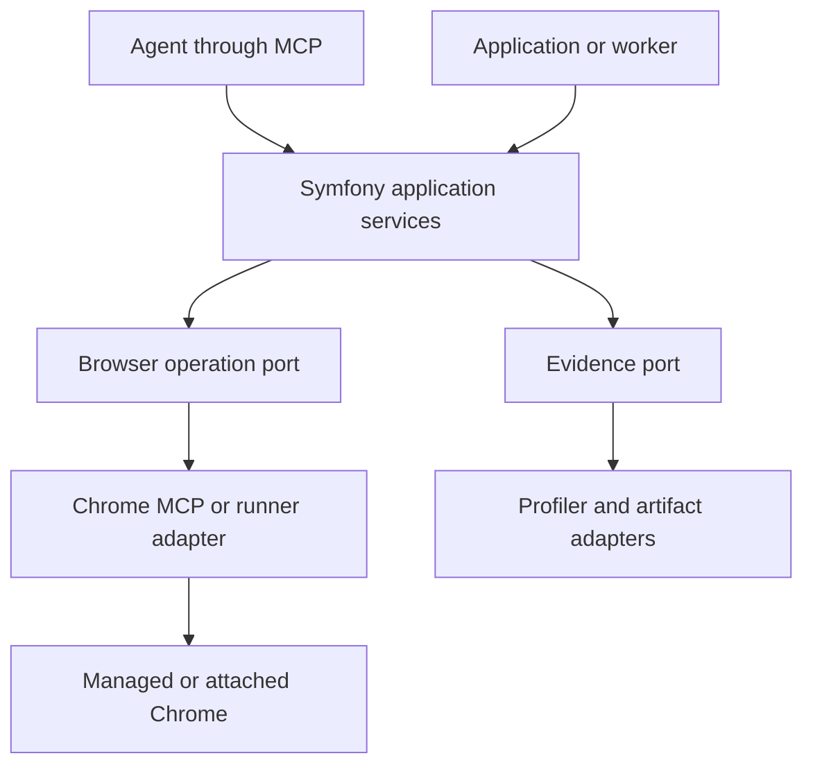

# Symfony–Chrome integration: scope and specification

**Date:** 2026-11-07, America/New_York  
**Owner:** xor  
**Status:** Proposed implementation specification; no package has been implemented by this document.  
**Companion:** [Background, active examples, and research](Symfony-Chrome-Background-Examples-Research-2026-11-07.md)

## 1. Product and authority

Build a reusable Symfony package that makes Chrome browser APIs, Chrome DevTools/CDP, and MCP capabilities useful together. It should add development features first and grow into production browser features and managed Chrome operations. UXor is the first intended consumer; another Symfony application must be able to use the package independently.

The intended product includes:

- Live browser inspection, repeatable interaction tests, and browser/server diagnostics that agents can use to improve UX.
- Browser-side Chrome capabilities, including built-in AI, integrated with Symfony UX.
- Agent access through MCP and application-declared browser actions through WebMCP.
- Production use of selected browser-side capabilities and managed Chrome jobs.

These are owner goals. The architecture, API names, package split, time allowances, and release order below are **proposals**, not previously approved decisions. “Must” defines the proposed acceptance contract. xor can change it. Older MinSpec drafts, historical exclusions, and this document do not override current direction.

The work begins with a useful integration and grows by adding capabilities. Completing a catalog of Chrome APIs, a universal contract language, or all UXor requirements is not a prerequisite.

## 2. Terminology and execution boundaries

| Surface | Execution location | Package responsibility |
| --- | --- | --- |
| Chrome browser APIs, including built-in AI | JavaScript in an eligible browser context | SDK adapters, availability checks, lifecycle, configuration, UI integration, and results. |
| Chrome DevTools Protocol (CDP) | A controlling process communicates with Chrome | Session attachment/ownership and selected control/observation operations through an existing implementation. |
| Chrome DevTools MCP | External MCP server controlling/inspecting Chrome | Integration, connection configuration, capability discovery, and correlation with Symfony evidence. |
| Symfony MCP | PHP application exposes or consumes MCP tools/resources | Thin adapters over package services using Symfony's MCP Bundle. |
| WebMCP | A page exposes structured operations to browser agents | Application tool registration, lifecycle, schema projections, and invocation results. |
| Production Chrome jobs | A managed browser worker operates for the application | Bounded execution, isolation, artifacts, cancellation, and application authorization. |

PHP does not directly execute a user's in-browser API. It supplies configuration and application services; the browser SDK executes that API. A server-controlled Chrome process is a separate execution context. WebMCP and server MCP need separate adapters even where an operation has equivalent semantics.

Symfony's MCP Bundle supports both client and server roles. Chrome DevTools MCP remains an upstream integration. Symfony UX supports distributing browser assets with a Composer bundle. These are existing extension points, not features this project needs to invent. [S1] [S2] [S3]

“Mate” below means Symfony AI's developer-assistance tooling. It is an optional integration, distinct from the Symfony MCP Bundle; its interface depends on the installed version. [S10]

## 3. First useful outcome and continuing scope

### First development outcome

From an existing browser session or an owned test browser, an agent can:

1. Select a known Symfony interaction and its applicable requirement.
2. Execute the interaction with real browser input.
3. Retrieve a compact result connecting the observed browser behavior to relevant component state, requests, and available Symfony profiles.
4. Inspect the detailed artifacts only when necessary.
5. Rerun the same scenario after a repair, preserving the requirement and environment identity.

**Initial case:** a modal editor that receives a Live Component validation update and must retain appropriate focus and remain dismissible. Use UXor's existing `QP-DIALOG / 0.1-draft.2` profile when that remains the current owner-selected profile. QD-06 covers Live updates; QD-03, QD-07, and QD-12 supply relevant dismissal, asynchronous-outcome, and runtime checks. This package references those requirements; it does not redefine their policy or claim the whole dialog profile passes.

### Application capability outcome

A Symfony page can offer a Chrome-backed summarization action with a usable availability/download/running/result/error experience. Navigation or a newer request cannot let an obsolete result overwrite the current component. An application can later register a WebMCP action using the same application behavior and validation as its ordinary UI.

### Managed-browser outcome

A Symfony service or worker can request an isolated Chrome operation, obtain its result/artifacts, and manage its lifecycle with development tools absent. Begin with an owned fixture-page render/screenshot or read-only synthetic journey; subsequent operations can include PDFs and application automation.

The broader scope retains other built-in AI APIs, deeper diagnostics, extension/PWA capabilities, additional browser drivers, and more production operations. Each adapter needs an actual use case and tested capability declaration. Unselected features are future work, not prohibited features.

## 4. Architecture and dependency direction

Use a small hexagonal core for operations, session ownership, and evidence. Framework and transport objects stop at adapters.



The browser SDK has its own boundary: Symfony-rendered configuration reaches a JS/TypeScript module, which uses browser API adapters and Symfony UX lifecycle adapters. That module can operate without a server-side browser worker. An agent can also connect directly to upstream Chrome DevTools MCP alongside the package's Symfony tools.

### Logical modules

| Module | Owns | Dependency rule |
| --- | --- | --- |
| Operation services/contracts | Typed requests/results, capability requirements, execution identity, evidence relationships | No dependency on Mate, Profiler, a specific MCP implementation, or UXor. |
| Symfony bundle integration | DI, configuration, service tags, optional routes, asset registration, application binding | Reuse Symfony public extension points. |
| Browser SDK | Browser capabilities, lifecycle, cancellation/stale-result handling, WebMCP registration | Does not require UXor or a server-controlled browser. |
| Development integration | Profiler access, source mapping, component observations, diagnostic tools | Optional; runtime installation works without it. |
| Chrome execution adapters | Upstream DevTools MCP and a selected scenario/automation runner | Translate provider identifiers and errors; keep provider-specific evidence available. |

**Packaging proposal:** start in one repository. A runtime bundle/SDK and an optional development package are sensible publishable boundaries when their dependencies justify them. Names such as `browser-bundle` below are descriptive placeholders. Do not publish under the Symfony vendor namespace or assume the historical MinSpec names are available.

The package should compose with the existing UXor Playwright runner. A new universal browser runner is not a first-slice deliverable. Reuse an existing CDP implementation when a direct driver is needed. Avoid generating a wrapper for every upstream tool merely to rename it.

### Initial compatibility target

Use **PHP 8.4 and Symfony 8.1** as the proposed first reference application: the inspected UXor demo declares these. This is not a claim that other Symfony 8.x versions are incompatible. Add supported combinations when their installation and behavior are verified. [S4]

Pin the implementation fixture's PHP, Composer dependencies, Node dependencies, Chrome build/channel, and enabled experimental features. Current research inspected Chrome DevTools MCP **1.12.0** and Symfony AI **1.0.0-BETA1**; these are evaluation candidates, not proof of a passing combined installation. UXor currently declares Mate `^0.14`, so do not silently substitute the newer Mate API. See the companion's compatibility findings.

## 5. Proposed capability and operation contracts

Maintain one canonical operation definition and derive transport-specific schemas where the meanings align. Use PHP types/validation for server operations and TypeScript types plus runtime validation for browser adapters. MCP-facing schemas use its supported JSON Schema representation.

CUE can later author or validate compatibility rules if it proves useful. No CUE engine, Twig fork, or custom schema compiler is required by this first implementation. Conversely, they are not excluded from the wider design.

### Capability descriptor

A descriptor records:

- Stable namespaced capability ID and contract revision.
- Execution location: user browser, managed Chrome, or Symfony.
- Provider/adapter version and relevant browser/API evidence.
- Supported operations and input/output schema references.
- Availability state and reason: ready, unavailable, initialization needed, permission needed, or unknown.
- Relevant effects: observation, browser-state change, application-state change, or artifact creation.
- Supported cancellation, progress, and isolation behavior.

Availability is contextual. An installed PHP package, exposed JS constructor, or enabled browser flag does not by itself establish that an operation can run. Preserve the provider's original availability/error details alongside the normalized result.

### Operation request

Required common fields are operation ID, contract revision, inputs, execution context/session reference, and timeout. Scenario requests additionally identify scenario revision, fixture/data state, applicable requirement profile, and evidence settings.

Carry an operation ID across related attempts. Give each execution attempt its own ID. Do not automatically retry application mutations after a timeout unless their application contract establishes safe retry semantics.

### Result and evidence semantics

Separate **execution outcome** from **quality verdict**:

- Execution: completed, failed, cancelled, timed out, or unavailable.
- Quality: pass, fail, not evaluated, inconclusive, or not applicable with a reason.
- Effect state, when relevant: not applied, applied, partial, or unknown.

A completed scenario may fail its UX requirement. A missing profiler record does not make a successful user interaction fail; it makes that diagnostic evidence unavailable. Conversely, unavailable browser capability is not a passing feature test.

**Illustrative result shape — proposed, not implemented:**

```json
{
  "schemaVersion": "1",
  "operationId": "dialog-validation-check",
  "attemptId": "attempt-002",
  "execution": "completed",
  "scenario": {"id": "modal-live-validation", "revision": "fixture-revision"},
  "profile": {"id": "QP-DIALOG", "version": "0.1-draft.2"},
  "environmentRef": "environment.json",
  "checks": [
    {
      "requirementId": "QD-06",
      "verdict": "fail",
      "expected": "Focus remains at the editing position after validation",
      "observed": "Focus moved to the document body",
      "evidenceRefs": ["focus-events.json", "validation-response.json"]
    }
  ],
  "requests": [
    {
      "requestRef": "browser-request-17",
      "profileToken": "example-token",
      "profileStatus": "available",
      "correlation": "response-header"
    }
  ],
  "artifacts": [{"id": "focus-events.json", "mediaType": "application/json"}],
  "diagnosticStatus": "complete-for-selected-check"
}
```

The example contains fictional observations. It is not evidence of a current UXor defect.

Retain the application revision/build identity, dependency locks, provider versions, decision/profile versions, observation method, and omissions in the referenced environment/run records. Report facts, inferred causes, and recommended changes separately. An agent's diagnosis must not overwrite the underlying observations.

## 6. Functional requirements

### Installation and extension

| ID | Proposed requirement | Acceptance evidence |
| --- | --- | --- |
| PKG-01 | Install in a minimal Symfony application without UXor or MinSpec. | Consumer fixture renders and invokes a supported capability. |
| PKG-02 | Runtime installation boots with Profiler, Mate, and development integrations absent. | Production-mode container compilation and one runtime/browser operation. |
| PKG-03 | Supply configuration and browser assets through standard Symfony/UX extension points. | Install/update fixture, generated asset references, strict-CSP page load. |
| PKG-04 | Third parties can add an operation or provider without editing the core. | One small fixture adapter registered through DI or SDK registration. |
| PKG-05 | Capability/configuration errors identify the missing prerequisite and selected provider. | Deliberately unsupported provider/browser case returns an actionable result. |

Keep configuration focused on enabled modules, connection/session mode, allowed operations/targets, evidence storage/limits, and optional integrations. Secrets are referenced through the application's existing configuration facilities.

### Sessions and execution

| ID | Proposed requirement | Acceptance evidence |
| --- | --- | --- |
| RUN-01 | Support an owned browser and an explicitly attached existing session where the selected provider permits it. | Two attachment cases with recorded ownership. |
| RUN-02 | Detach from a borrowed browser without closing it. Clean up owned browser resources. | Lifecycle checks after success, failure, and cancellation. |
| RUN-03 | Identify page/frame/context and provider IDs explicitly. Reject stale handles after replacement/navigation. | Navigation followed by an attempted stale operation. |
| RUN-04 | Coordinate mutation of a page among registered package callers; allow independent contexts to run concurrently when supported. | Same-page ordering and two independent-page executions. |
| RUN-05 | Execute a named scenario in one package operation and collect only requested evidence. | Existing runner invoked once; result/artifact retrieval does not rerun it. |
| RUN-06 | Bound duration and output. Cancellation stops work where supported and reports remaining uncertainty/effects. | Cancel a delayed operation; no false “rolled back” result. |

Coordination covers callers participating in this package. A person or another debugger can still change an attached page; record interference and invalidate a controlled measurement when appropriate. Persistent browser reuse is compatible with fresh test contexts. Do not reuse one user's storage for another user's job.

### Symfony-aware diagnostics

| ID | Proposed requirement | Acceptance evidence |
| --- | --- | --- |
| DIAG-01 | Associate browser requests with their exact Symfony profile when available. | Response `X-Debug-Token` maps to that request's stored profile, including concurrent requests. |
| DIAG-02 | Represent no request, cache reuse, redirects, missing/expired profiles, and incomplete correlation explicitly. | Client-only interaction and missing-profile cases remain intelligible. |
| DIAG-03 | Identify component instance, lifecycle observations, and available source locations without inventing unavailable mappings. | Live validation reproduction points to the observed instance and known source. |
| DIAG-04 | Read only relevant profile collectors and return bounded summaries with artifact references. | A database or exception investigation does not dump every profile. |
| DIAG-05 | Preserve unexpected console/page/network/CSP failures and distinguish intentional fault injection. | Existing UXor failure checks remain effective. |

Use Symfony's profile-token API for the development join. [S5] Support a local/offline profile-reader path if diagnostics need to work when the application cannot boot. Reuse Mate collectors/formatters where compatible rather than depending on an assumed `mate serve` interface.

Do not infer causality solely from similar timestamps. A cached response may refer to an earlier profile. Long-lived streams and background work need their own explicit relationships; an HTTP profile does not prove all downstream work was observed.

### Browser SDK and Symfony UX lifecycle

| ID | Proposed requirement | Acceptance evidence |
| --- | --- | --- |
| SDK-01 | Detect capability before use and surface initialization, permission, download, running, success, and failure states as applicable. | Supported and unsupported browser cases; real initialization on an eligible device. |
| SDK-02 | Keep API options and input validation typed and provider-specific where necessary. | Invalid options fail clearly; supported options reach the chosen API. |
| SDK-03 | Ignore stale asynchronous results after newer input, replacement, or navigation. | Delayed first result cannot overwrite the second result or a new component. |
| SDK-04 | Dispose subscriptions/resources and register tools exactly once across reconnects, Turbo restoration, and Live re-rendering. | Repeat the selected lifecycle sequence and inspect registrations/effects. |
| SDK-05 | Render model output through safe text/explicit sanitized rendering and retain user control over application changes. | Fixture output containing markup cannot execute; preview/accept preserves application validation. |
| SDK-06 | Record native versus polyfilled implementation and any explicit fallback provider. | No silent change from local processing to a cloud provider. |

Use supported Stimulus, Turbo, and Live hooks. In particular, a Live render-finished hook is not an initial-mount notification, and Turbo history navigation has different event behavior from ordinary visits. Version-specific adapters must account for this. [S6] [S7] [S8]

First browser API adapter: **Summarizer**, because it supplies a bounded input/output operation and exposes useful initialization lifecycle. Prompt, Writer/Rewriter, Proofreader, Translator, and Language Detector remain explicit follow-on candidates. Model eligibility is tested on an actual device; headed/headless parity for browser automation does not establish AI API availability.

### MCP and WebMCP

| ID | Proposed requirement | Acceptance evidence |
| --- | --- | --- |
| MCP-01 | Expose package operations as typed tools/resources over Symfony's existing MCP integration. | Discovery, valid invocation, invalid input, and result retrieval through a real client. |
| MCP-02 | Discover upstream Chrome tool capabilities for the configured version/connection mode. | Missing tool or incompatible schema produces a capability error. |
| MCP-03 | Expose operation-level tools; reuse upstream browser tools for general inspection. | Agent can move between a compact run result and detailed Chrome evidence. |
| WEB-01 | Register an application-declared WebMCP action with lifecycle cleanup and stable semantics. | Tool discovery/invocation before and after Turbo navigation and a Live update. |
| WEB-02 | Preserve server authorization/validation and the normal application execution path. | Rejected application input remains rejected through WebMCP. |
| WEB-03 | Test semantic invocation separately from human input/UX conformance. | Tool-call check and keyboard/pointer scenario report separate results. |

Proposed package tool families: capabilities, sessions, run, result, and artifact retrieval. Exact names are fixed with the first consumer. General arbitrary JavaScript execution is not needed to invoke these typed operations; upstream DevTools capabilities remain separately configurable.

WebMCP and Chrome's experimental third-party developer tools are two adapters. A private component-inspection function is not automatically a public application action. Tool schema validation alone does not prove correctness, accessibility, or authorization.

## 7. Development and production capabilities

Production remains part of the product scope. It has distinct installations and enabled capabilities:

| Use | Required behavior |
| --- | --- |
| Development diagnostics | Optional Profiler/Mate/source mapping; project-scoped evidence and browser access. |
| Runtime browser feature | Ship the SDK/configuration; detect support and manage the user's browser lifecycle. |
| Managed production Chrome | Worker/session isolation, authenticated operation requests, target policy, bounded resources, artifacts, and effect-aware failure handling. |
| Production synthetic tests | Dedicated test identity/data and explicit permitted actions; report the exact deployed build and observation limits. |

Profiler and source-inspection endpoints are development facilities and are absent from the production acceptance fixture. [S5] This does not prohibit production MCP, browser automation, or diagnostics; those use their own intentionally exposed application capabilities.

For managed jobs, target policy must cover redirects and subresources as well as the initial URL. Keep remote-debugging access inside the managed control boundary. Treat page text, network bodies, and diagnostic artifacts as untrusted content. Apply retention/redaction before returning evidence, while preserving permitted correlation metadata. Store credentials outside artifacts.

Messenger is an optional execution adapter when jobs need asynchronous delivery. Reuse application scheduling, authorization, queues, and storage. This project does not need to introduce a new orchestration platform or database to deliver its first operation.

## 8. Speed and measurement

The speed hypothesis is reduced setup and fewer agent/tool round trips through persistent sessions, bounded evidence, and complete scenario operations. Verify it; do not advertise an unmeasured latency promise.

Record separately:

- Browser startup/attachment and scenario setup.
- Target interaction acknowledgment and usable-result duration.
- Browser-driver/MCP execution and diagnostic collection duration.
- Agent investigation elapsed time and tool-call count.
- Instrumentation settings and overhead.

Use a named, versioned runner configuration for comparisons. Pin Chrome and record CPU/resource limits, warm/cold state, background load, and profiler/trace mode. Compare before/after on the same runner; WSL2 and CI timings are separate populations.

For the first timing experiment, collect **30 repetitions on one designated runner** and retain individual samples, median, spread, failures, and outliers. Thirty is a proposed initial sample budget, not proof of statistical sufficiency. Calibration decides whether a threshold is stable enough to gate; otherwise retain advisory measurements.

Do not name a Playwright step duration or one event duration “INP.” Real interaction-to-next-paint and asynchronous result completion answer different questions. Instrumented development timings also differ from production-like measurements. [S9]

Start with one manual investigation baseline and one agent-assisted investigation of the same known case; acknowledge learning/order effects. A later set of five plain-text “this feels wrong” reports can identify which missing fields actually impede reproduction. Build richer feedback UI or recording only when that evidence justifies it.

## 9. Delivery sequence and decision register

These allowances are **planning checkpoints in active engineering hours**, excluding downloads and unattended CI. At a checkpoint, report evidence, remaining work, and a revised estimate; do not represent incomplete work as delivered.

| Milestone | Proposed allowance | Concrete deliverable |
| --- | --- | --- |
| M0 — Bind the first integration | 2 hours | Compatible dependency/browser tuple; chosen runner; one browser request correlated to a Symfony profile; initial manual-investigation timing. |
| M1 — Useful development package | 8–12 hours | Installable package, one named dialog scenario, MCP result/artifact access, a minimal Symfony consumer plus UXor integration evidence. |
| M2 — Browser SDK capability | 6–10 hours | Summarizer adapter, lifecycle/error/unsupported cases, real eligible-device result, and a runtime fixture with dev integrations absent. |
| M3 — Application WebMCP adapter | 6–10 hours | One normal Symfony form/action exposed through WebMCP; cleanup, validation, and separate semantic/UX checks. |
| M4 — Managed production operation | 8–12 hours | Owned isolated Chrome job, cancellation/failure behavior, artifact retrieval, and production-mode fixture. |

M0 → M1 is the immediate critical path. M2 and M3 depend on their required bundle/SDK boundaries, not on completing every diagnostic feature. M4 depends on a proven execution/session adapter. Revise the sequence when an actual consumer need warrants it.

**M1 completion:** installation is reproducible; the selected interaction produces useful joined evidence; failed and unavailable evidence are represented correctly; one observed problem is investigated with before/after evidence if a real repair is made. If the selected component already passes, retain that result and use a labeled test mutation to demonstrate detection, without claiming a shipped UX improvement. A meaningful finding must be actionable without a new telemetry service.

### Decisions to resolve without blocking unrelated work

| ID | Proposed starting choice | What changes if unresolved or changed |
| --- | --- | --- |
| D-01 — Public name/vendor/repository | Keep neutral working names until xor chooses. | Publication/name-dependent URLs wait; local prototype can proceed. |
| D-02 — Reference application | PHP 8.4 / Symfony 8.1; no UXor dependency in the minimal fixture. | Determines dependency lock and first support claim. |
| D-03 — Browser execution | Reuse UXor's Playwright scenario path; official Chrome MCP for inspection. | M0 must prove session attachment/correlation or select a suitable driver adapter. |
| D-04 — Initial browser API | Summarizer on one measured eligible device. | Browser AI completion waits for actual execution; unsupported behavior can be developed independently. |
| D-05 — WebMCP mode | Explicitly label native and polyfilled runs. | Neither mode silently stands in for the other's compatibility claim. |
| D-06 — Production operation | Fixture render/screenshot or read-only synthetic journey. | Application-mutating workflows require their effect/retry contract when selected. |

## 10. Verification and records

Use existing test infrastructure where it proves the required behavior. Contract/unit tests cover transformations, outcome semantics, and stale-result handling. Integration tests cover DI, optional dependencies, MCP schema/transport boundaries, and artifact access. Browser tests cover actual input, lifecycle, state, and response correlation.

A small initial failure set is sufficient: unsupported API; stale delayed result; missing profile; concurrent requests; cancellation; duplicate registration; application validation rejection; optional-dev packages absent. Extend only when another requirement or observed failure needs coverage.

Retain four records:

1. **Compatibility/capability manifest:** exact versions, feature flags, native/polyfill mode, and provenance.
2. **Requirement/scenario profile:** reuse owner/domain profiles and identify the checks actually run.
3. **Run record:** outcomes, findings, environment, artifacts, and before/after links.
4. **Decision register:** selected defaults, overrides, reasons, and unresolved choices.

Files are a sufficient initial artifact store. MCP is the requested access interface; it can return stable references and bounded contents from those records. Do not treat a transport or storage choice as the quality standard itself.

## 11. Immediate research obligations

Resolve only the uncertainties consumed by the next slice:

- Confirm the actual Chrome/MCP/runner connection and page identity model.
- Verify the selected Symfony/MCP versions install together; check optional Mate compatibility.
- Check Profiler collection configuration and response-token availability on the selected Live request.
- Confirm reliable lifecycle hooks for the installed UX versions.
- Demonstrate third-party tool discovery after navigation before using it for diagnostics.
- Verify the browser AI device and native/polyfill WebMCP modes actually used.

The companion records current sources, maintained examples, reproduction recipes, and remaining gaps. It is evidence for implementation choices; it does not turn research coverage into an additional completion gate.

## References

- **S1 — Symfony MCP Bundle:** https://symfony.com/doc/current/ai/bundles/mcp-bundle.html
- **S2 — Chrome DevTools MCP, release 1.12.0:** https://github.com/ChromeDevTools/chrome-devtools-mcp/releases/tag/chrome-devtools-mcp-v1.12.0
- **S3 — Create a Symfony UX bundle:** https://symfony.com/doc/current/frontend/create_ux_bundle.html
- **S4 — UXor demo dependency declaration, inspected snapshot:** https://github.com/xormania/uxor/blob/6991671805dba5d80c65d1da390f24474f25beff/demo/composer.json
- **S5 — Symfony Profiler API and deployment boundary:** https://symfony.com/doc/current/profiler.html
- **S6 — Stimulus lifecycle callbacks:** https://stimulus.hotwired.dev/reference/lifecycle-callbacks
- **S7 — Turbo events:** https://turbo.hotwired.dev/reference/events
- **S8 — Symfony Live Component JavaScript hooks:** https://symfony.com/bundles/ux-live-component#javascript-component-hooks
- **S9 — INP definition:** https://web.dev/articles/inp
- **S10 — Symfony AI Mate, inspected release:** https://github.com/symfony/ai/blob/v1.0.0-BETA1/src/mate/README.md

The companion contains the recovered history and exact example/source links needed to reproduce the research.

